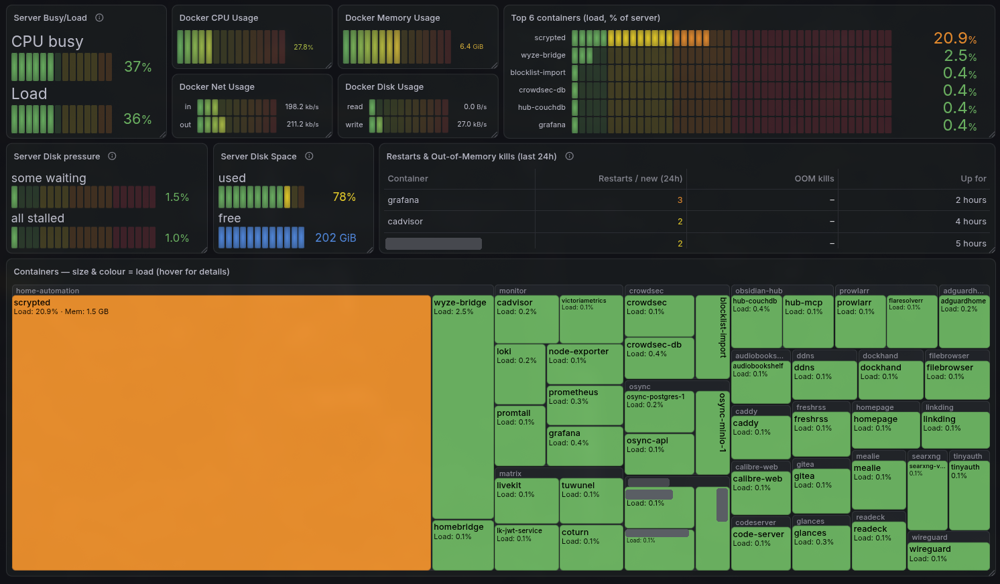

# DockerTree

[](https://grafana.com/grafana/download)
[](https://prometheus.io/)
[](https://github.com/google/cadvisor)
[](https://github.com/prometheus/node_exporter)
[](https://www.docker.com/)
[](https://github.com/samjage/dockertree/blob/main/LICENSE)

A Grafana panel that shows all your Docker containers as a treemap. The busier a container is, the bigger and hotter its tile. Every tile shows the full container name, its load and its memory, so you can spot the noisy one at a glance.



_The [ready-made dashboard](#ready-made-dashboard) on a real Docker host, treemap grouped by stack._

## Features

- **Size and colour = load.** Uses Grafana's standard **Thresholds**, **Unit** and **Decimals** options, so you set the colour bands the usual way.
- **Readable names.** Tiles are sized by load, but never smaller than a minimum (default 80 px), so small containers still show their name. Set **Minimum tile size** to 0 to size tiles strictly by value.
- **Load and memory on the tile**, plus a hover card with group, load, memory and network.
- **Group by stack** (optional): one box per Docker Compose project with its containers inside.
- **Any data source.** It needs one row per container with a name label. Prometheus + cAdvisor works out of the box.

## Requirements

- Grafana **13.2 or later** (self-hosted or Grafana Cloud).
- Container metrics. The examples use [cAdvisor](https://github.com/google/cadvisor) scraped by Prometheus. The panel itself works with any data source that returns one row per container.
- [node-exporter](https://github.com/prometheus/node_exporter) for the [ready-made dashboard](#ready-made-dashboard): its server tiles (CPU busy, load, disk pressure and space) and the CPU core count. Not needed for the panel alone.

## Install

**From the Grafana plugin catalog** (once the plugin is published): in Grafana go to **Administration → Plugins and data → Plugins**, search for DockerTree and click **Install**. Or from the command line:

```bash
grafana cli plugins install samjage-dockertree-panel
```

**From a GitHub release** (works before the catalog listing):

1. Download `samjage-dockertree-panel-<version>.zip` from the [releases page](https://github.com/samjage/dockertree/releases).
2. Unzip it into your Grafana plugins folder (`/var/lib/grafana/plugins` by default), so you get `/var/lib/grafana/plugins/samjage-dockertree-panel/`.
3. Until the plugin is signed by Grafana, allow it to load unsigned. In `grafana.ini`:

   ```ini
   [plugins]
   allow_loading_unsigned_plugins = samjage-dockertree-panel
   ```

   or, in Docker, the environment variable `GF_PLUGINS_ALLOW_LOADING_UNSIGNED_PLUGINS=samjage-dockertree-panel`.

4. Restart Grafana.

## Ready-made dashboard

[`dashboards/dockertree.json`](dashboards/dockertree.json) is a complete Docker host dashboard: server load, Docker CPU / memory / network / disk, the top 6 containers, disk pressure and space, restarts and out-of-memory kills, and a DockerTree treemap of every container.

To use it: **Dashboards → New → Import**, upload the file (or paste its grafana.com ID once published) and pick your Prometheus data source. It needs cAdvisor, node-exporter and the DockerTree plugin.

## Setup with Prometheus and cAdvisor

To build your own panel instead, add a DockerTree panel and three **instant** queries with **Format: Table**:

| Query | Meaning                                                  | Example                                                                                                                                                  |
| ----- | -------------------------------------------------------- | -------------------------------------------------------------------------------------------------------------------------------------------------------- |
| A     | tile size and colour: CPU load as % of the whole machine | see below                                                                                                                                                |
| B     | memory in bytes (optional)                               | `sum by (name, stack)(label_replace(container_memory_working_set_bytes{name!=""}, "stack", "$1", "container_label_com_docker_compose_project", "(.+)"))` |
| C     | network in bits/s, shown on hover (optional)             | `sum by (name)(rate(container_network_receive_bytes_total{name!=""}[2m]) + rate(container_network_transmit_bytes_total{name!=""}[2m])) * 8`              |

Query A:

```promql
sum by (name, stack)(
  label_replace(rate(container_cpu_usage_seconds_total{name!=""}[2m]),
    "stack", "$1", "container_label_com_docker_compose_project", "(.+)")
) * 100 / scalar(count(count by (cpu)(node_cpu_seconds_total)))
```

(Without node-exporter, replace the `scalar(...)` with your number of CPU cores.)

### Stacks

The `stack` label comes from the Docker Compose project name. cAdvisor exports it by default; if you run cAdvisor with `--store_container_labels=false`, add `--whitelisted_container_labels=com.docker.compose.project`.

Containers that were not started by Docker Compose (plain `docker run`) have no stack. They still appear, and with **Group by stack** on they share one box called **no stack**.

## Options

| Section          | Option                       | Default                   |                                                                               |
| ---------------- | ---------------------------- | ------------------------- | ----------------------------------------------------------------------------- |
| Queries          | Size & colour query          | `A`                       | refId of the query that sets tile size and colour                             |
| Queries          | Memory query                 | `B`                       | refId giving memory bytes; empty hides memory                                 |
| Queries          | Network query                | `C`                       | refId giving bits/s; empty hides network                                      |
| Queries          | Name label / Group label     | `name` / `stack`          | label or column names                                                         |
| Layout           | Group by stack               | off                       | one box per group                                                             |
| Layout           | Minimum tile size            | 80                        | smallest tile in px; bigger tiles stay sized by value; 0 = size by value only |
| Tiles            | Value label                  | `Load`                    | word before the value on each tile                                            |
| Tiles            | Show value and memory        | on                        |                                                                               |
| Standard options | Unit / Decimals / Thresholds | percent / 1 / 5 · 15 · 25 | colours: green, yellow, orange, red                                           |

## Development

```bash
npm install
npm run dev        # build and watch
npm run test:ci    # unit tests
docker compose up  # Grafana with a demo dashboard (sample data) on http://localhost:3000
```

## License

Apache-2.0
